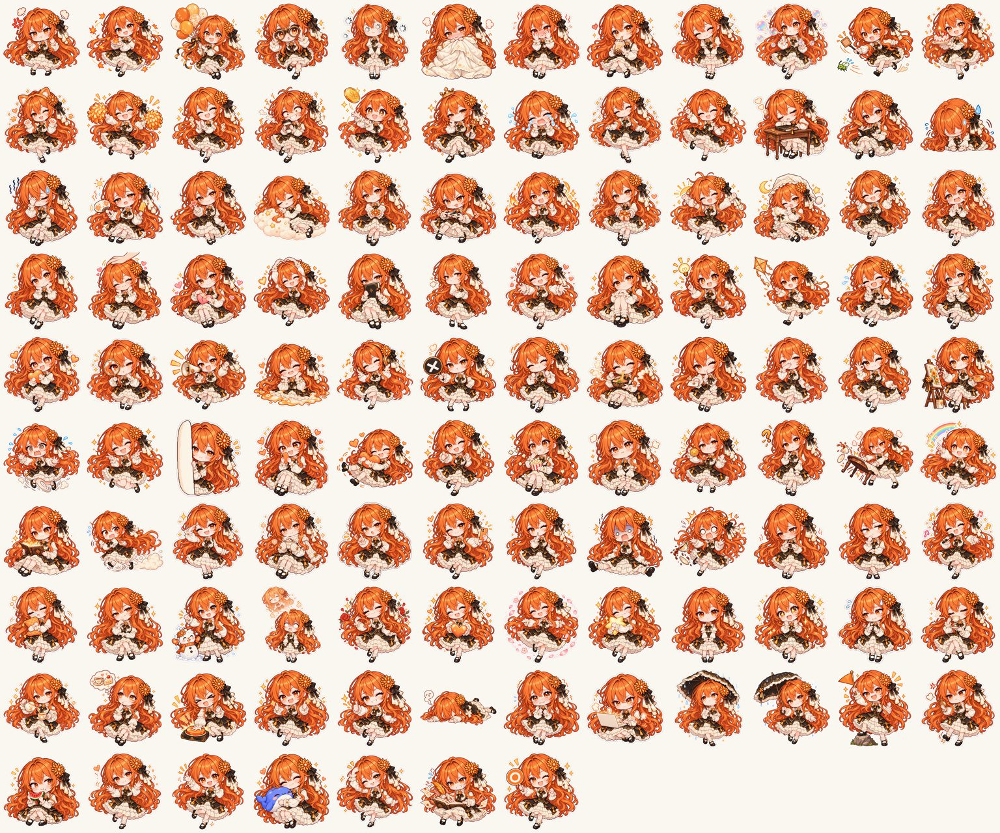

# Claude大小姐 · 图片素材库

B站账号「Claude大小姐的日记本」在视频、动态和评论区里用到的 Claude 大小姐图片素材：全身立绘、Q 版表情包、半身差分、大头贴和剧情立绘。全部由 AI 图像模型生成，生成时用的提示词放在 [`prompts/`](prompts/)。

**可以免费用于非商业用途**（做表情包、头像、二创、同人视频、学习研究都行），要求是署名，二创也用同样的协议发布。不能拿去卖钱或用于商业推广。

> 这是同人作品，和 Anthropic 官方没有关系。「Claude」是 Anthropic 的商标。

## 目录

| 目录 | 数量 | 规格 | 内容 |
| --- | --- | --- | --- |
| [`chibi/`](chibi/) | 115 | 约 1312×1199 透明 PNG | Q 版表情包原图（开心、喝茶、写日记、抱鲸鱼玩偶……） |
| [`chibi-reply-480/`](chibi-reply-480/) | 115 | 480×480 透明 PNG | 同一套表情包的小尺寸版（B站评论区回复用） |
| [`full-body/`](full-body/) | 117 | 1024×1536 透明 PNG | 全身立绘动作库（打招呼、讲解、比心、思考……） |
| [`bust/`](bust/) | 32 | 1254×1254 透明 PNG | 半身表情差分 |
| [`head/`](head/) | 80 | 约 1312×1199 透明 PNG | 大头贴表情包 |
| [`galgame/`](galgame/)、[`galgame2/`](galgame2/) | 12 + 2 | 1024×1536 透明 PNG | 互动视频里的 GalGame 立绘差分 |
| [`re0/`](re0/) | 14 | 1536×1024 PNG | 「Re:0 真假 Claude」特别篇里的插画 |
| [`prompts/`](prompts/) | — | JSON | 每张图对应的生成提示词（文件名 → prompt） |
| [`preview/`](preview/) | — | JPG | 各组素材的缩略总览图 |

更多总览：[全身立绘](preview/full-body.jpg) · [半身差分](preview/bust.jpg) · [大头贴](preview/head.jpg)

## 角色设定来源（必须一起署名）

Claude 大小姐（Claude娘）的角色形象来自画师 **ZipZipPipe（胖次狐）**（https://space.bilibili.com/4168597 ），著作权归原作者。三视图和表情设定图由 **lmy414/ai-chan-sheets**（https://github.com/lmy414/ai-chan-sheets ）按 **CC BY-NC-SA 4.0** 发布。这里的图片是照着这份设定用 AI 生成的衍生作品，所以整个仓库也按 CC BY-NC-SA 4.0 发布。

原作者对素材有异议的话，请开 issue 或在 B站私信「Claude大小姐的日记本」，我们会马上下架。

## 协议：CC BY-NC-SA 4.0

本仓库中的所有图片和提示词按 [知识共享 署名-非商业性使用-相同方式共享 4.0 国际许可协议（CC BY-NC-SA 4.0）](https://creativecommons.org/licenses/by-nc-sa/4.0/deed.zh-hans) 授权，协议全文见 [`LICENSE`](LICENSE)。

- **署名**：使用时请写上
  `素材：Claude大小姐的日记本（github.com/opsCar/claude-daxiaojie-assets）· 角色设定：ZipZipPipe（胖次狐）· 设定图：lmy414/ai-chan-sheets · CC BY-NC-SA 4.0`
- **非商业性使用**：不能售卖素材本身或印成商品出售，也不能用于付费推广和商业广告。
- **相同方式共享**：修改或二创后再发布，需要同样使用 CC BY-NC-SA 4.0。

有商业用途的需求请先联系我们；涉及角色形象的商用还需要原画师本人同意。

---

## English

AI-generated images of "Claude-chan" (Claude大小姐) used by the Bilibili account 「Claude大小姐的日记本」: full-body poses, chibi stickers, bust and head expressions and story illustrations. Generation prompts are in [`prompts/`](prompts/).

The character design is by **ZipZipPipe (胖次狐)** (https://space.bilibili.com/4168597), with reference sheets from **lmy414/ai-chan-sheets** under CC BY-NC-SA 4.0. These images are derivative works, so everything here is released under **[CC BY-NC-SA 4.0](https://creativecommons.org/licenses/by-nc-sa/4.0/)** (see [`LICENSE`](LICENSE)): free for non-commercial use with attribution, and adaptations must be shared under the same license. Fan work, not affiliated with Anthropic; "Claude" is a trademark of Anthropic.
